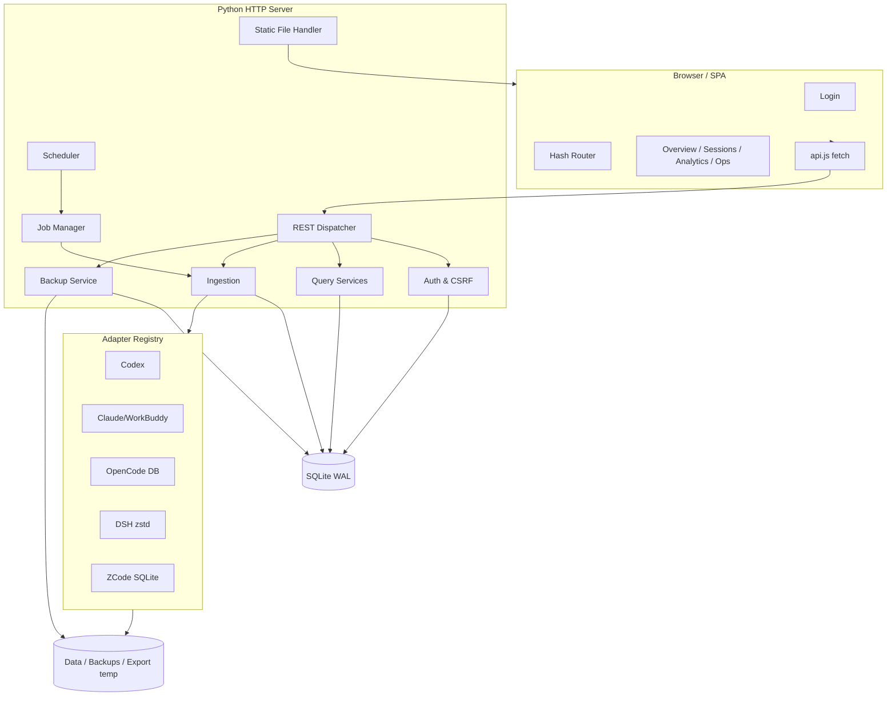
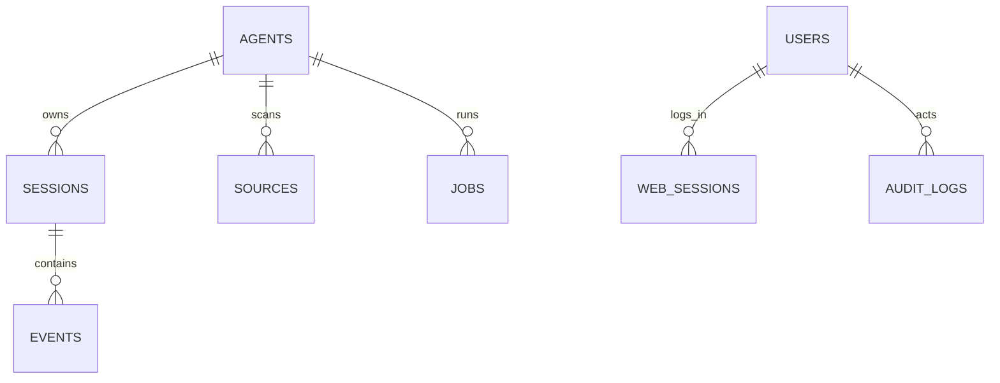

# 迹录 AgentTrail · 架构设计

版本：1.0.0  
定位：本地优先、单机、无外部依赖的 AI Agent 聊天记录采集与档案系统。

---

## 1. 设计目标

### 必须满足

1. 接入七类 Agent，可选择启用，不修改原始数据。
2. 将异构记录统一规范化为四类结构。
3. 支持按 Agent、时间范围统计与导出，导出结果可直接分析。
4. 支持采集任务配置、进度监控、增量同步、幂等去重与失败重试。
5. 数据持久化、搜索筛选、分页浏览。
6. 访问控制、备份、日志与配置管理。
7. 结构清晰、可扩展、可维护。

### 明确不做

- 不做云端同步、多租户 SaaS 或在线协作。
- 不修改 / 删除原始 Agent 会话。
- 不提供在线数据库恢复（避免写入冲突与误覆盖）。
- 不在浏览器端保存长期凭据或明文密码。

### 关键约束

- 仅使用 Python 标准库即可运行；`zstandard` 为可选依赖。
- 前端无构建步骤、无外部 CDN，浏览器直接加载 ES Modules。
- 单进程 + SQLite，适合个人工作站与小型团队。
- 默认只监听回环地址，远程访问需自行加 HTTPS 反向代理。

---

## 2. 运行时架构



### 分层职责

| 层 | 模块 | 职责 |
|---|---|---|
| 接入层 | `server.py` | HTTP、Cookie、CSRF、路由、静态资源、文件下载、错误映射 |
| 认证层 | `auth.py` | 密码哈希、登录限流、Web 会话、用户与角色 |
| 采集层 | `collectors.py` | 数据源发现、路径展开、文件读取、zstd 解压、OpenCode SQLite |
| 规范化层 | `parsers.py` | 将每种来源映射到统一 session / event batch |
| 领域层 | `ingestion.py` | 事务写入、会话聚合、fingerprint 去重、同步编排 |
| 调度层 | `jobs.py` | 任务队列、工作线程、自动重试、定时调度、自动备份 |
| 查询层 | `analytics.py` | 总览、统计、会话/事件查询、任务/日志、全局搜索 |
| 导出层 | `exporting.py` | CSV / JSONL / JSON / ZIP、数据字典、manifest |
| 迁移层 | `importing.py` | 旧 chatlog 导出库预览、按会话转换、后台导入运行与断点 |
| 运维层 | `backup.py` / `db.py` | 在线备份、日志、配置、审计、表计数 |
| 展示层 | `web/` | 登录、总览、会话、详情、统计、任务、备份、日志、设置、文档 |

---

## 3. 请求生命周期

### 3.1 登录

1. 浏览器 `POST /api/auth/login`，带 `X-AgentTrail-Request: 1`。
2. 服务端校验 Origin 与 Host 一致。
3. 检查 IP 登录限流。
4. 查询用户，PBKDF2 校验密码；失败记录审计。
5. 生成 40 字节随机 token，数据库存 SHA-256 哈希。
6. 设置 HttpOnly + SameSite=Strict Cookie，返回用户信息。
7. 后续请求通过 Cookie 恢复用户，写入审计。

### 3.2 采集任务

1. 管理员 `POST /api/agents/{key}/sync`。
2. `JobManager` 检查该 Agent 是否有在途任务；有则返回已有任务。
3. 写入 `jobs` 行（queued），放入线程安全队列。
4. 工作线程取任务，标记 running。
5. `sync_agent`：
   - 读取 Agent 配置；
   - 发现数据源；
   - 对每个源读取增量 batch；
   - `import_batch` 事务落库；
   - 更新 source 游标与状态；
   - 更新 Agent 状态。
6. 成功 / 部分失败 / 失败写回任务与统计快照。
7. 任务失败时按指数退避重试；耗尽后保留错误，可手动重跑。
8. 调度器每隔 30 秒检查各 Agent 的 `last_scan_at + interval`，自动排队。

### 3.3 查询

1. 路由解析查询参数。
2. 服务端动态拼接**受控** SQL 条件与参数绑定。
3. 先 count 后分页查询，避免一次加载全表。
4. 返回统一 JSON，前端用 DOM 字符串渲染（所有动态内容转义）。

### 3.4 导出

「数据导出」页（`web/assets/pages/export.js`，路由 `#/export`）与旧导出对话框共用同一套接口，但提供跨会话的批量筛选：AGENTS 多选、事件类型多选、闭区间日期与快捷范围。多选组内为 OR、组间为 AND；日期在前端按本地自然日转换为 UTC 毫秒边界（`00:00:00.000` ~ `23:59:59.999`），服务端统一用 `>=` / `<=` 比较 `events.timestamp`。

1. UI 先调 `GET /api/export/estimate`，用与导出完全相同的筛选参数试算条数、会话数与体积，超限直接禁用按钮；响应额外带 `by_agent`（只应用除 Agent 外的条件），让每张 Agent 卡片显示自己的命中数。
2. 服务端按筛选条件 count；超过 `export_max_rows` 返回 413。
3. 生成临时文件：
   - CSV：UTF-8 BOM、公式注入防护；
   - JSONL：逐行写出；
   - ZIP：写 events.csv、sessions.csv、summary.json、manifest.json、data_dictionary.md。
4. 审计记录导出条件与数量。
5. 以附件流式发送；发送后删除临时文件。

### 3.5 备份

1. 管理员手动或调度器触发。
2. 打开源 SQLite 与临时目标，执行 `backup()`。
3. gzip 压缩为 `agenttrail-YYYYMMDD-HHMMSS.db.gz`。
4. 写入 `backups`，按保留策略删除旧备份。
5. 记录系统日志与审计；下载通过受保护的 GET 接口完成。

### 3.6 旧数据导入

1. GET /api/import/candidates 扫描库所在目录，用 export_meta 识别旧 chatlog 导出库。
2. GET /api/import/preview?path= 以 mode=ro&immutable=1 只读打开源库，按旧 source 统计会话 / 消息 / 推理 / 工具与时间范围，并给出映射结果。
3. POST /api/import/runs 校验文件后写入一条 queued 运行记录，交给单后台线程执行；已有任务时返回 409。
4. 工作线程按 session_pk 分块读取：每个会话把旧 messages 行转换成四类事件（工具结果按 FIFO 配对最近一次工具调用），再调用 ingestion.import_batch 写入，指纹固定为旧 row_id。
5. 每完成一个会话推进 cursor_session_pk；轮询 GET /api/import/runs/{id} 读取进度，POST .../cancel 设置取消标记。
6. 结束后写 success / partial / failed / canceled 与统计；服务启动时把遗留的 queued / running 标记为 interrupted，重新导入即可续传已写入部分。

---

## 4. 数据模型

### 4.1 ER 关系



### 4.2 agents

| 字段 | 类型 | 说明 |
|---|---|---|
| key | TEXT PK | codex / claudecode / opencode / workbuddy / deepseekharness / zcode |
| name, vendor, description | TEXT | 展示信息 |
| color, icon | TEXT | UI 标识 |
| enabled | INTEGER | 是否参与自动调度；手动同步不受限制 |
| config_json | TEXT | roots、patterns、auto_sync、interval_minutes、max_attempts |
| status | TEXT | idle / syncing / ok / warning / error / disabled |
| status_message | TEXT | 最近状态摘要 |
| last_scan_at / last_success_at / last_error_at | TEXT | 调度与诊断 |

### 4.3 sessions

| 字段 | 说明 |
|---|---|
| id | 自增主键 |
| agent_key + external_id | 唯一会话标识 |
| title / project / model / cwd | 展示与筛选 |
| started_at / ended_at | UTC ISO |
| user_message_count / assistant_message_count | 消息聚合 |
| tool_call_count / tool_result_count | 工具聚合 |
| event_count / message_count | 总量 |
| tokens_input / tokens_output | 会话级 Token |
| source_path / metadata_json | 溯源 |

索引：`(agent_key, started_at DESC)`、`started_at DESC`、`updated_at DESC`、`project`。

### 4.4 events

| 字段 | 约束 |
|---|---|
| type | CHECK IN 四类 |
| session_id | FK → sessions，级联删除 |
| source_event_id | 来源事件 ID |
| timestamp | UTC ISO |
| content | 正文 / 结果 |
| tool_name / tool_call_id / tool_status | 工具链 |
| tool_input_json | 入参 |
| tokens_input / tokens_output | 事件级 |
| fingerprint | UNIQUE，幂等键 |
| raw_json | 原始记录（最大约 500KB） |

索引：`(session_id, timestamp, sequence, id)`、`(agent_key, timestamp)`、`(type, timestamp)`、`tool_name`、`tool_call_id`；
聚合专用的覆盖索引 `(agent_key, type, timestamp, tokens_input, tokens_output, session_id)`、`(timestamp, agent_key, type)`、
`(type, tool_status, session_id, tokens_input, tokens_output)`，以及只覆盖工具行的部分索引
`(tool_name, tool_status) WHERE type='tool_call'`、`(tool_status) WHERE type='tool_result'`。
覆盖索引让总览/统计的聚合停在索引页，部分索引让工具统计只扫工具行。

### 4.5 sources

每个数据源一行：路径、类型、大小、mtime、cursor_json、状态、最近错误、最近同步、累计导入。

### 4.6 jobs

字段：Agent、trigger、status、attempts、max_attempts、progress、message、stats_json、error、queued/started/finished。

状态机：

```text
queued ──> running ──> success
                    ├─> partial
                    └─> failed
queued ──> cancelled (预留)
failed / partial / success ──> 手动重试（创建新任务）
```

### 4.7 import_runs

字段：源文件路径 / 名称、status、options_json、total / processed / imported / skipped 会话数、imported / duplicate 事件数、skipped 消息数、cursor_session_pk、errors / warnings / summary、创建者与起止时间。

状态机：

```text
queued ──> running ──> success
                    ├─> partial
                    ├─> failed
                    └─> canceled
queued / running ──> interrupted（服务重启时回收）
```

与 jobs 分开：导入不属于单个 Agent，且允许跨多个来源连续写入。

### 4.8 users / web_sessions

- 用户：用户名唯一（NOCASE）、password_hash、salt、role、active、must_change_password。
- 会话：token_hash、user_id、expires_at、last_seen_at、ip、user_agent。
- 服务端仅存哈希，原文 token 只在 Cookie 中。

### 4.9 audit_logs / system_logs / backups / settings

- 审计：动作、目标、详情、IP、时间；只追加。
- 系统：级别、模块、消息、详情；供日志页与故障排查。
- 备份：文件名、路径、大小、备注、创建者、时间。
- 配置：key/value JSON。

---

## 5. 规范化协议

### 5.1 统一批次

解析器输出：

```python
{
  "agent_key": "codex",
  "source_path": "...",
  "sessions": [{"external_id": "...", "title": "...", ...}],
  "events": [{
      "session_external_id": "...",
      "type": "tool_call",
      "source_event_id": "...",
      "sequence": 3,
      "timestamp": "2026-11-03T01:02:03.000Z",
      "content": "",
      "tool_name": "read_file",
      "tool_call_id": "call-1",
      "tool_status": "completed",
      "tool_input_json": "{\"path\":\"a.txt\"}",
      "model": null,
      "tokens_input": null,
      "tokens_output": null,
      "metadata_json": "{}",
      "raw_json": null
  }],
  "errors": []
}
```

任何适配器只要产出这个结构，就能复用落库、统计、检索、导出与 UI。

### 5.2 各适配器要点

**Codex**

- `session_meta.payload.session_id` / cwd / originator。
- `response_item.message` 只取 user / assistant，忽略 developer / system。
- `function_call` / `custom_tool_call` → tool_call，参数解析为 JSON。
- `function_call_output` / `custom_tool_call_output` → tool_result。
- `event_msg.item_completed` 在 response_item 缺失时兜底；已出现的内容哈希不会重复。
- `token_count.total_token_usage` 写入会话级 Token 上限。

**Claude Code / WorkBuddy**

- 每行可能是 `type: user/assistant`（Claude）或 `type: message + role`（WorkBuddy）。
- `message.content` 的 block 类型：
  - `text / input_text / output_text` → 消息；
  - `tool_use` → tool_call；
  - `tool_result` → tool_result；
  - `thinking / reasoning` → 当前忽略。
- 工具结果消息不会生成一条空 user_message。
- WorkBuddy 的 `<system-reminder>` 被移除，`<user_query>` 内的真实问题被提取。
- WorkBuddy 还会把工具写成顶层 `function_call / function_call_result` 事件，解析器同样映射为 tool_call / tool_result。
- 支持顶层 `toolUseResult` 作为结果兜底。

**OpenCode**

- 只读打开 `opencode.db`。
- 查询 `session_v2 + session_message + project`。
- 用户消息取 `data.text`；assistant content blocks：
  - `text` → assistant_message；
  - `tool` → tool_call + 可选 tool_result（来自 state.content / output）。
- 增量条件为 `session_message.time_updated > cursor.updated_ms`。
- 连接使用 `mode=ro`，不写数据库。

**DeepSeek Harness**

- 会话文件为 `session.v4.jsonl.zstd`，同一文件可能包含多个 zstd frame。
- 必须使用 `ZstdDecompressor().stream_reader()` 连续解压；只解首帧会丢消息。
- 事件映射：
  - `user/message` → user_message（过滤 runtime-context / skill 注入）；
  - `assistant/message` 的 text → assistant_message，tool-call → tool_call；
  - `tool/result` → tool_result；
  - `tool/call` 与 `tool/ptc-dispatch` 为重复信息，跳过。
- 压缩文件大小/mtime 未变则跳过；变化则重扫，fingerprint 去重。

**ZCode**

- 主来源是 `~/.zcode/cli/db/db.sqlite`，以 `mode=ro` 只读打开；WAL 模式下 `db.sqlite-wal` 由 SQLite 自动读取，未落盘的会话不会漏采。
- 表结构与 OpenCode v1 相近：`session` 存会话元数据，`message` 存消息信封（含 `tokens` / `modelID`），`part` 存 text / reasoning / tool 片段。
- 事件映射：
  - 一条 user message 的多个 `text` part 合并为一条 user_message，`file` part 记入 `metadata.attachments`；
  - `text` → assistant_message；`reasoning` → assistant_message（`metadata.reasoning = true`）；
  - `tool` → tool_call；`state.status` 为 completed / error / failed 或存在 output / error 时，再生成一条 tool_result（`tool_call_id = callID`）；
  - `step-start / step-finish / snapshot / patch / timeline / compaction` 跳过。
- 增量条件：`message.time_updated` 或 `part.time_updated` 大于游标；命中后整条消息重读，fingerprint 去重，因此工具后补的 output 会更新原 tool_result。
- 会话 token 取 `model_usage` 按 `session_id` 汇总（含重试消耗）；缺少该表时回退到消息 `data.tokens`。
- 仍保留通用 JSON / JSONL 适配器，用于接入导出的实验性会话目录。

**VS Code Copilot**

- 会话文件位于 `workspaceStorage/<hash>/chatSessions/<uuid>.jsonl` 与 `globalStorage/emptyWindowChatSessions/*.jsonl`。
- 文件是追加式日志：首行 `kind: 0` 为完整快照，后续 `kind: 1/2/3` 分别为「按路径赋值 / 按路径追加 / 删除」。
- 解析器先回放补丁得到当前 `session` 对象，再读取 `requests[]`：
  - `request.message.text` → user_message；
  - `response[]` 中的 `text / markdownContent` → assistant_message；
  - `thinking` → assistant_message（`metadata.reasoning = true`）；
  - `toolInvocationSerialized` → tool_call + tool_result（`toolCallId` 关联，`resultDetails` / `resultError` 为结果）。
- 因为 VS Code 会压缩重写文件，Copilot 来源不使用字节游标，而是整文件回放 + fingerprint 去重。

### 5.3 消息清洗

- 去除完整的 `<system-reminder>…</system-reminder>` 与常见注入上下文。
- WorkBuddy 优先提取 `<user_query>…</user_query>`。
- 用户消息中的纯上下文 wrapper 不产生事件。
- 代码块、Markdown 保留，前端渲染时先转义再格式化。

---

## 6. 增量同步算法

### 6.1 未压缩 JSONL

```text
cursor.offset = N
open(file).seek(N)
data = read_to_eof()
cut = data.rfind(b'\n') + 1
if cut == 0: 不推进 cursor
lines = data[:cut].decode().splitlines()
parse(lines)
cursor.offset = N + cut
```

优点：不会读到半行 JSON；追加写入时只处理增量。

### 6.2 zstd / 整文件

不保存解压后偏移，保存 `{size, mtime_ns, done}`。文件未变直接跳过；文件变化全量重解压，依靠事件指纹去重。DSH 的追加式压缩通常表现为文件大小变化。

### 6.3 SQLite

保存 `updated_ms`。每次查询时间戳大于游标的消息；更新同一消息时取最新内容。初次同步从 0 开始。OpenCode（`session_message`）与 ZCode（`message` + `part`）共用该策略，ZCode 额外把 `part.time_updated` 纳入游标判定。

### 6.4 指纹生成

稳定键：

```text
agent | session_external_id | event_type | source_event_id | tool_call_id
```

对合成 ID（以 `line-` 开头）追加内容 / 时间 / 入参哈希，避免增量块内行号重置造成碰撞。

同一指纹再次出现时：

- 计入 `duplicates`；
- 如正文或状态变化，就地更新；
- 不新增事件，不改变会话计数。

---

## 7. 任务调度与失败处理

### 7.1 工作线程

- 默认 2 个工作线程，共享 `queue.Queue`。
- 一个 Agent 同时只允许一个 queued/running 任务。
- 任务进度回调写回 `jobs`，前端任务页每 5 秒自动刷新。

### 7.2 自动重试

- 每次任务最多 `max_attempts` 次（Agent 配置，默认 3）。
- 退避时间：1s、2s、4s… 最大 8s。
- 全部数据源失败才抛出 `SyncError`；部分失败返回 partial，不自动重试（避免对确定性解析错误反复扫描）。
- 失败任务可手动重跑，产生新任务保留历史。

### 7.3 调度器

- 首次启动等待约 30 秒，避免抢占启动响应。
- 每 30 秒：
  - 清理过期 Web 会话；
  - 根据 `last_scan_at + interval` 自动排队；
  - 检查自动备份是否到期。
- 自动同步只处理 enabled 且 `auto_sync=true` 的 Agent。

### 7.4 异常隔离

- 单个数据源异常不阻断其他来源。
- 单个解析行错误写入 source warning，任务可继续。
- 工作线程捕获所有异常，记录系统日志，不会因单个任务退出。

---

## 8. WebUI 设计

### 8.1 技术

- 原生 ES Modules，无打包器。
- Hash 路由：`#/overview`、`#/sessions/:id` 等。
- 页面模块按需导入；共享 `core.js`（状态、格式化、图表、模态框、toast、分页）。
- 所有动态文本经过 HTML 转义；Markdown 只支持安全子集。
- 内联 SVG 图标；无外部字体 / CDN。
- 启动时请求 `/api/health` 校验 `api_revision` 与 `stale`：后端未返回版本、版本号与前端常量（`web/assets/app.js` 的 `API_REVISION`）不一致，或磁盘代码比进程启动时间新时，页面底部提示重启服务。静态资源使用 `no-cache`，避免更新后浏览器继续使用旧脚本。

### 8.2 页面状态

- URL 保存筛选条件（Agent、时间、关键词、分页），可刷新 / 分享。
- 页面切换时 AbortController 终止旧事件监听，防止内存泄漏。
- 任务页激活时定时刷新；路由离开后清理。
- 作业轮询驱动侧边栏 / 顶栏状态。

### 8.3 交互流程

**Agent 配置**

```text
Agent 卡片 → 配置 → 编辑 roots / patterns / 调度 / 重试
           → 保存 → PATCH /api/agents/{key}
           → 重新加载 Agent 状态
```

**浏览会话**

```text
会话列表筛选 → 打开会话
→ 按四类事件筛选 / 会话内搜索
→ 查看工具入参 / 结果
→ 大字段按需 GET /api/events/{id}
→ 导出本会话：对话框勾选角色 / 日期
→ GET /api/export?session_id=…&types=…
```

**分析导出**

```text
统计分析 → 选时间范围 / Agent
→ 趋势 / 结构 / 工具 / 项目
→ 选时间范围（含自定义日期）与事件角色
→ GET /api/export/estimate 试算 → GET /api/export → 浏览器下载
```

**批量导出**

```text
左侧「数据导出」→ 多选 Agent / 事件类型
→ 选日期快捷项或填写起止日期（本地自然日，闭区间）
→ 实时试算（含每个 Agent 的命中数）
→ GET /api/export?agents=…&from=…&to=…&types=…&format=bundle
→ 浏览器下载
```

---

## 9. 安全设计

| 风险 | 控制 |
|---|---|
| 未授权访问 | 登录 + Cookie 会话；所有 /api（除公开接口）校验 |
| 权限提升 | 角色检查在服务端；前端隐藏不是安全边界 |
| 会话窃取 | HttpOnly + SameSite=Strict；Secure 可选 |
| 暴力破解 | 5 分钟 / IP 限流；失败审计 |
| CSRF | 写请求强制自定义头；Origin/Host 校验 |
| XSS | 动态内容转义；Markdown 安全子集；CSP |
| SQL 注入 | 全部参数绑定；排序字段白名单 |
| 路径穿越 | 静态文件解析后必须位于 web 根目录 |
| 公式注入 | CSV 单元格前缀中和 |
| 敏感数据外泄 | 仅本地监听；备份/导出需受控存放 |
| 提权文件访问 | 采集器只读配置路径；不修改原文件 |

---

## 10. 性能与容量

- 会话列表：count + 分页 SQL；不加载事件正文。
- 会话详情：事件分页，正文默认截断到 12,000 字符；完整内容单独接口。
- 搜索：SQL `LIKE` + 关键索引；中文子串可靠。大规模可迁移 FTS5。
- 统计：会话级 Token 与计数已聚合；事件趋势按天分组。
- 聚合查询：总览 KPI、按 Agent 汇总、工具排行、区间统计全部由覆盖索引直接读出，不再回表；
  工具成功率与类型直方图合并为两次索引扫描。
- 查询计划：`init_db` 在索引版本变化时执行一次 `ANALYZE`（版本号存于 `settings.db_stats_version`），
  采集结束调用 `PRAGMA optimize` 增量刷新统计；否则规划器会挑较小的 `(type, timestamp)` 索引并回表，
  聚合耗时相差一个数量级。
- 采集写入：整批事件用 `IN` 分块预取 fingerprint 与合并所需列，避免逐条 `SELECT *` 把 `raw_json`
  拖进内存；12 万事件档案上单批 2,000 条新增约 60 ms，重复同步约 20 ms。
- 连接：WAL 只在建库时设置，其余为 `synchronous=NORMAL`、32 MB cache、`temp_store=MEMORY`、256 MB mmap，
  单次连接开销约 1 ms。
- 导出：临时文件流式发送；限制 200,000 行，防止内存爆炸。
- SQLite WAL 支持读写并发；长任务使用短事务分批提交。
- 大量源文件单次发现上限 5,000；单个文件上限 1,024MB（可配置）。

### 扩展建议

- 数据量 > 500 万事件：按月份分区 / 归档冷数据，或迁移 PostgreSQL。
- 多用户并发写入：将采集器作为独立 worker，Web 与数据库分离。
- 搜索增强：增加 FTS5 + 中文分词，或 Meilisearch。
- 采集增强：支持对象存储 / 远程日志；为每个适配器增加 schema 版本探测。

---

## 11. 测试策略

- **解析器单元测试**：每类 Agent 的最小真实结构、工具链、注入清理。
- **存储测试**：重复导入、聚合、统计、搜索、分页。
- **导出测试**：CSV BOM、ZIP 内容、公式注入。
- **安全测试**：认证、角色、CSRF、路径。
- **端到端**：Playwright / 浏览器手动检查所有页面、移动端布局、弹窗与错误态。
- **故障注入**：不存在的目录、损坏 JSON 行、不可读文件、SQLite schema 不匹配、zstd 缺失。

---

## 12. 运维手册

### 日志

- 系统日志：服务启动、采集完成、源错误、调度器异常、备份失败。
- 审计日志：登录 / 失败登录、配置、导出、备份、用户管理。
- 源状态：每文件的 cursor、last_error、last_synced_at、导入数量。

### 备份策略

- 建议首次同步后立即备份。
- 自动备份默认 24 小时，保留 7 份；重要升级前手动创建。
- 备份包含敏感凭据哈希，注意访问权限。
- 恢复前停止服务，避免覆盖 WAL 中的数据。

### 升级 schema

- 当前 `init_db` 使用 `CREATE TABLE IF NOT EXISTS` 与新增索引；新增字段需要迁移脚本。
- 建议升级流程：停止服务 → 备份 → 运行迁移 → 启动 → 核对总览与日志。
- 迁移脚本可放在 `scripts/`，并根据 `PRAGMA user_version` 版本化。

---

## 13. 后续路线

1. FTS5 全文索引与中文分词。
2. 增量统计缓存 / 物化视图。
3. 自定义 Agent 模板与 UI 导入（不写代码）。
4. 会话标签、收藏、备注与知识库导出。
5. 可选的定时清理 / 数据保留策略。
6. 审计日志导出与告警 Webhook。
7. 对象存储备份与加密备份。
8. 拆分采集 worker，支持多机采集。
