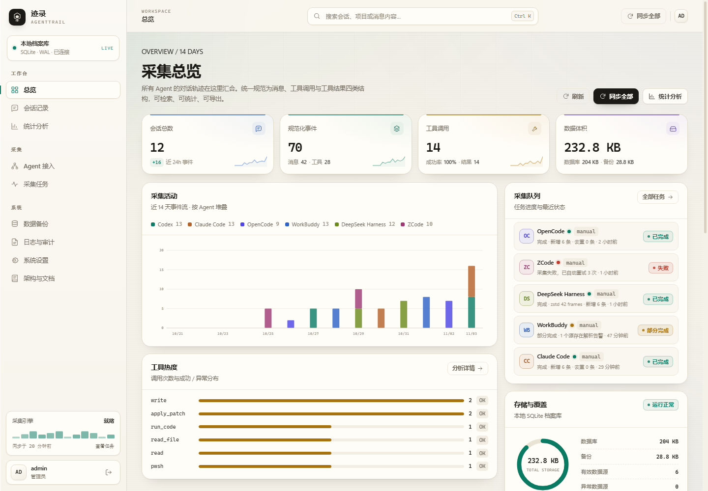
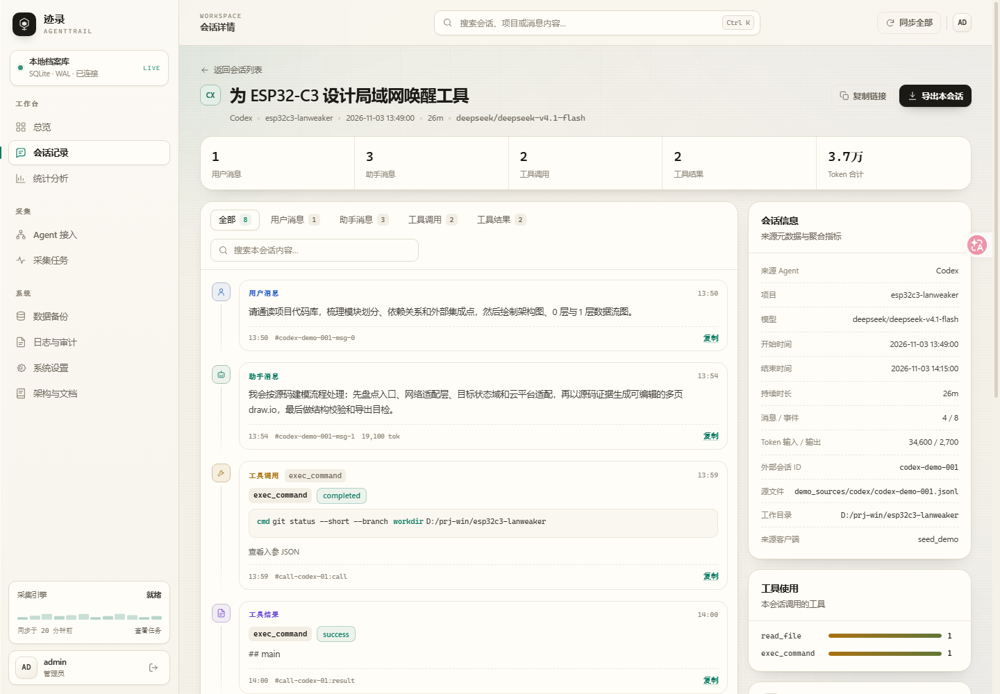
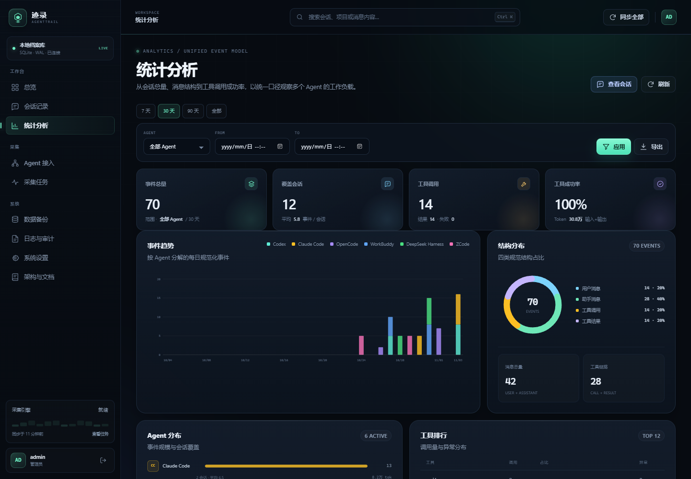
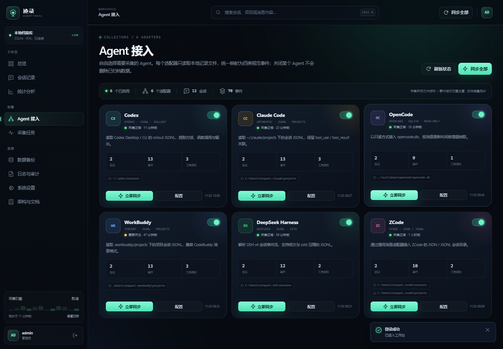
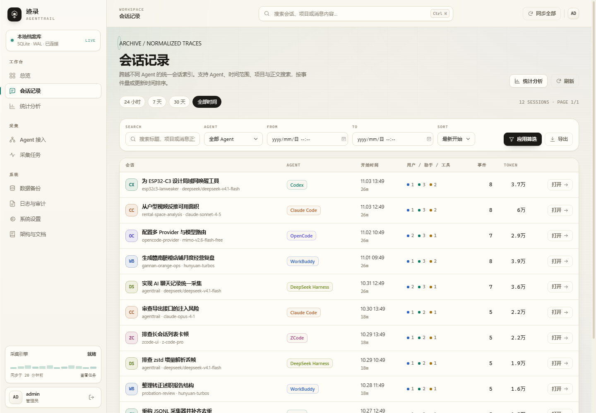
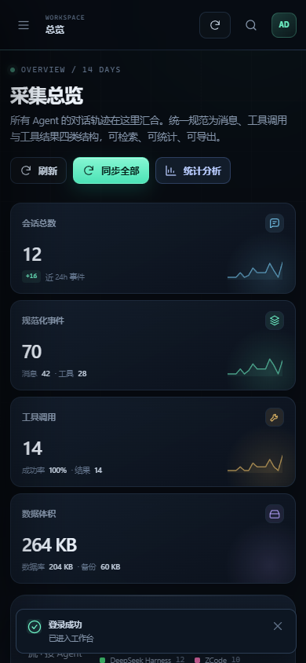
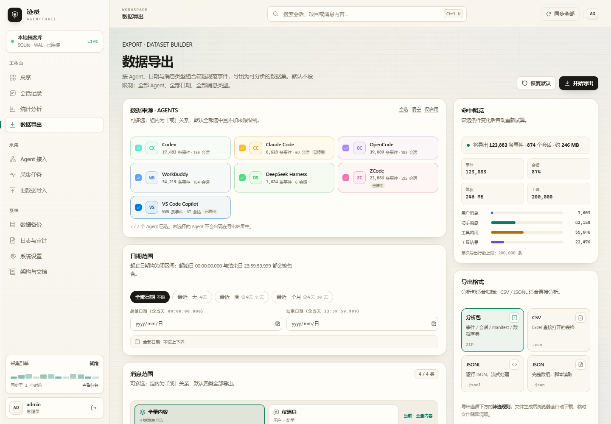
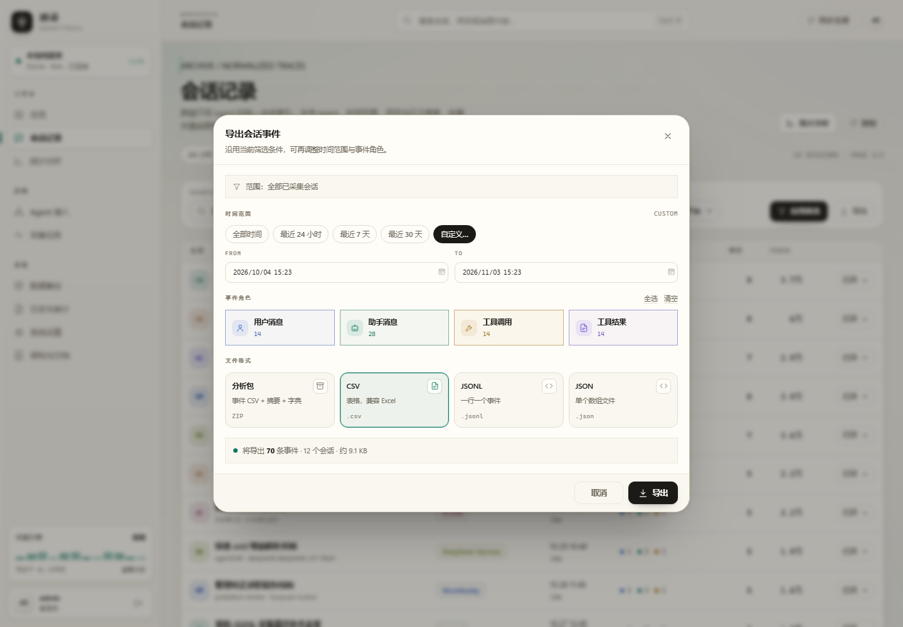
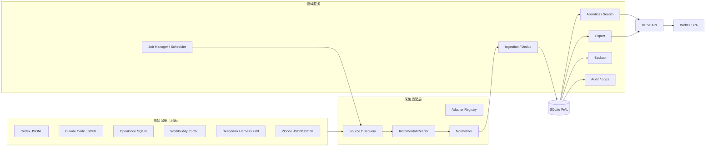

# 迹录 · AgentTrail

> 本地优先的 AI Agent 聊天记录管理器：接入 Codex、Claude Code、OpenCode、WorkBuddy、DeepSeek Harness、ZCode、VS Code Copilot，将异构会话统一为四类结构，并提供检索、统计、导出、采集调度、权限、备份与审计能力。


---

## 1. 这是什么

不同的 AI 编程 Agent 把会话写在不同的位置、不同的格式里：Codex 是 rollout JSONL，Claude Code / WorkBuddy 是 projects JSONL，OpenCode 是 SQLite，DeepSeek Harness 是追加式 zstd JSONL，ZCode 是通用 JSON / JSONL。

**迹录**把这些记录集中到一个本地 SQLite 档案库中。它只读访问原始文件，将每条记录规范化为：

1. 用户消息（`user_message`）
2. 助手消息（`assistant_message`）
3. 工具调用（`tool_call`）
4. 工具结果（`tool_result`）

然后提供统一 WebUI：按 Agent / 时间 / 关键词检索会话，分页浏览事件时间线，按 Agent 与时间统计，导出 CSV / JSONL / ZIP 分析包，并负责采集任务、增量游标、去重、失败重试、访问控制、备份与审计。

数据不离开本机，不依赖云服务，不使用外部前端 CDN。

---

## 界面预览

| 总览 | 会话详情 |
|---|---|
|  |  |

| 统计分析 | Agent 接入 |
|---|---|
|  |  |

| 会话记录 | 移动端 |
|---|---|
|  |  |

| 数据导出（多 Agent · 日期 · 消息类型） | 导出对话框（自定义日期 + 角色勾选 + 实时试算） |
|---|---|---|
|  |  |

---

## 2. 功能总览

### 采集与同步

- 七类内置 Agent 适配器，可在 WebUI 中自由启用 / 停用。
- 每个 Agent 独立配置数据源路径、glob 模式、自动同步间隔、失败重试次数。
- 采集路径按**当前系统用户**通配：配置里保存「~/...」，换账号或换机器后自动指向新的用户目录，无需手改「C:/Users/Administrator/...」。
- JSONL 使用**字节游标**只消费完整换行；SQLite 使用消息更新时间增量读取；zstd 来源按文件大小/mtime 去重重扫。
- 事件 **fingerprint 唯一索引**保证跨次幂等，重复扫描不会重复入库。
- 单 Agent 同一时间只允许一个在途任务，避免游标竞争。
- 后台工作线程 + 定时调度器，支持立即同步、全量同步、自动调度与手动重试。
- 任务状态机：`queued → running → success / partial / failed`，时间与进度可视化。

### 数据与管理

- SQLite WAL 持久化，外键约束与事务写入。
- 会话列表支持 Agent、时间范围、标题/项目/正文关键词、排序与分页。
- 会话详情提供四类事件时间线、工具入参/结果、Token、来源元数据；大字段按需加载。
- 统计分析：事件趋势（按 Agent 堆叠）、四类结构占比、Agent 分布、工具排行、项目覆盖。
- 导出：事件 CSV、规范化 JSONL、分析包 ZIP（含数据字典与 manifest）。
- 数据备份：SQLite Online Backup API + gzip，自动保留策略、下载、手动删除。
- 旧版 chatlog 导出库导入：预览来源映射与规模，后台按会话迁移，按旧库行号去重，可取消、可重复执行。
- 访问控制：管理员 / 只读成员；HttpOnly + SameSite=Strict Cookie；登录限流；同源请求校验。
- 审计日志：登录、配置变更、导出、备份、用户管理。
- 系统日志与源文件状态页，可定位采集失败原因。
- 内置「架构与文档」页，运行时可查看数据模型与适配器映射。

---

## 3. 快速启动

### 环境

- Python 3.11+（当前实现只使用 Python 标准库）
- Windows / Linux / macOS
- 可选：`zstandard`，用于读取 DeepSeek Harness 的 `.jsonl.zstd` 会话

### 安装与启动

```bash
# 1) 可选：安装 zstd 支持
python -m pip install -r requirements-optional.txt

# 2) 可选：填充演示数据（会清空现有会话与事件）
python scripts/seed_demo.py --force

# 3) 启动
python app.py
```

Windows 也可以：

```powershell
powershell -ExecutionPolicy Bypass -File scripts/start.ps1
```

打开 **http://127.0.0.1:8787**。

### 初始管理员

- 默认用户名：`admin`
- 默认密码：`admin123`（可通过环境变量覆盖）

生产或共享环境请在首次启动前设置：

```powershell
$env:AGENTTRAIL_ADMIN_USER = "admin"
$env:AGENTTRAIL_ADMIN_PASSWORD = "一个足够长的随机密码"
python app.py
```

登录后立即在「系统设置 → 安全与会话」修改密码。系统仅监听 `127.0.0.1`；如需远程访问，请置于 HTTPS 反向代理之后并限制来源网段。

### 常用启动参数

| 参数 | 说明 |
|---|---|
| `--host` | 监听地址，默认 `127.0.0.1` |
| `--port` | 监听端口，默认 `8787` |
| `--db` | 指定 SQLite 路径 |
| `--no-scheduler` | 关闭自动同步 / 自动备份调度器，适合调试 |
| `--version` | 打印版本 |

环境变量：`AGENTTRAIL_DATA_DIR`、`AGENTTRAIL_DB`、`AGENTTRAIL_HOST`、`AGENTTRAIL_PORT`、`AGENTTRAIL_ADMIN_USER`、`AGENTTRAIL_ADMIN_PASSWORD`、`AGENTTRAIL_SECURE_COOKIE`、`AGENTTRAIL_DISABLE_SCHEDULER`、`AGENTTRAIL_ZSTD`。

---

## 4. 整体架构



更完整的设计说明见 [ARCHITECTURE.md](ARCHITECTURE.md)。

### 目录结构

```text
app.py                      # 启动入口
chatvault/
  server.py                 # HTTP / REST / 静态资源
  db.py                     # Schema、连接、配置、日志
  auth.py                   # 用户、密码、会话、限流
  parsers.py                # 七类 Agent 解析与规范化
  collectors.py             # 数据源发现、增量读取、OpenCode SQLite
  ingestion.py              # 事务落库、会话聚合、去重、同步编排
  jobs.py                   # 工作线程、任务状态机、调度器
  analytics.py              # 统计、搜索、分页、日志查询
  exporting.py              # CSV / JSONL / ZIP 分析包
  backup.py                 # 在线备份与保留策略
  constants.py / utils.py
web/
  index.html                # 单页应用外壳
  assets/app.css            # 视觉系统与响应式布局
  assets/app.js             # 登录、路由、全局交互
  assets/core.js            # API、格式化、图表、弹窗、toast
  assets/pages/*.js         # 十个页面模块
  assets/icons.js           # 内联 SVG 图标
scripts/
  start.ps1                 # Windows 启动脚本
  seed_demo.py              # 演示数据
tests/test_core.py          # 解析器 / 存储 / 导出 / 权限测试
data/                       # 运行时数据库、备份、日志（gitignore）
```

---

## 5. 数据模型

### 核心表

| 表 | 作用 | 关键约束 / 索引 |
|---|---|---|
| `agents` | 适配器与采集配置 | `key` 主键；配置 JSON |
| `sessions` | 统一会话索引 | `UNIQUE(agent_key, external_id)`；按 Agent + 时间、更新时间索引 |
| `events` | 四类规范事件 | `fingerprint UNIQUE`；session、agent+time、type+time、tool_name、tool_call_id 索引 |
| `sources` | 每个文件 / DB 的游标 | `UNIQUE(agent_key, path)` |
| `jobs` | 采集任务状态机 | status + Agent 索引 |
| `import_runs` | 旧数据导入运行记录（进度、统计、断点） | status + id 索引 |
| `users` / `web_sessions` | 成员与会话 | 用户名唯一；token 哈希存储 |
| `audit_logs` / `system_logs` | 审计与运行日志 | 时间倒序索引 |
| `backups` | 备份文件元数据 | 时间倒序索引 |
| `settings` | 全局配置 | key/value JSON |

### 事件结构

所有 Agent 的事件都写入同一张 `events` 表：

| 字段 | 说明 |
|---|---|
| `type` | `user_message / assistant_message / tool_call / tool_result` |
| `content` | 消息正文或工具结果正文 |
| `tool_name` / `tool_call_id` | 工具名与调用关联 ID |
| `tool_status` | success / error / completed 等 |
| `tool_input_json` | 工具入参 JSON |
| `timestamp` | UTC ISO-8601 |
| `sequence` | 来源内顺序 |
| `tokens_input` / `tokens_output` | 事件级 Token |
| `metadata_json` | 来源附加信息 |
| `fingerprint` | 幂等去重键 |

### 会话聚合

导入事件后，服务层在**同一个事务**中重算会话：

- 用户 / 助手消息数
- 工具调用 / 结果数
- 事件总数、消息总数
- 最早 / 最晚时间
- Token 输入 / 输出

因此统计页不需要实时扫描全部事件即可展示会话级指标，同时事件表仍然保留完整明细。

---

## 6. Agent 接入与规范化

| Agent | 默认位置 | 格式 | 主要映射 |
|---|---|---|---|
| Codex | `~/.codex/sessions`、`~/.codex/archived_sessions` | rollout JSONL | `response_item.message`、`function_call`、`function_call_output`；兼容 `event_msg.item_completed` 兜底 |
| Claude Code | `~/.claude/projects` | projects JSONL | `message.content` 中的 `text` / `tool_use` / `tool_result` |
| OpenCode | `~/.local/share/opencode/opencode.db`、`~/.local/share/opencode-linux/opencode.db` | SQLite 只读 | `session_v2` + `session_message`；从 assistant content blocks 提取工具及结果 |
| WorkBuddy | `~/.workbuddy/projects` | projects JSONL | 兼容 CodeBuddy 消息结构；顶层 `function_call / function_call_result` 映射为工具链；清理 `<system-reminder>`，提取 `<user_query>` |
| DeepSeek Harness | `~/.dsh/sessions` | `session.v4.jsonl.zstd` | `user/message`、`assistant/message`、`tool/result`；流式解压所有 zstd frame |
| ZCode | `~/.zcode/sessions`、`~/.zcode/projects` | JSON / JSONL | `role/content`、`tool_calls`、`tool_use` / `tool_result`，支持嵌套 `messages` 文档 |
| VS Code Copilot | `~/AppData/Roaming/Code/User/workspaceStorage`、`.../globalStorage/emptyWindowChatSessions` | JSONL 会话日志 | 回放 `kind 0/1/2/3` 快照与增量补丁，提取 `requests[].message`、响应文本、`toolInvocationSerialized` 工具调用与结果 |

路径支持 `~`、`%APPDATA%`、`$HOME` 等环境变量，可在 Agent 配置中覆盖为任意兼容目录。

### 采集目标与跨用户路径

旧工具曾把采集目标写成固定账号（如 `C:/Users/Administrator/...`）；换到另一台机器或另一个 Windows 账号后，这些路径会全部失效。AgentTrail 统一把用户目录视为**当前用户**：

| Agent | 旧工具中的采集目标 | 迁移后保存的模板 |
|---|---|---|
| Claude Code | `C:/Users/Administrator/.claude/projects` | `~/.claude/projects` |
| Codex | `C:/Users/Administrator/.codex/sessions`、`archived_sessions` | `~/.codex/sessions`、`~/.codex/archived_sessions` |
| OpenCode（Linux 数据） | `~/.local/share/opencode-linux/opencode.db` | `~/.local/share/opencode-linux/opencode.db` |
| OpenCode（本机数据） | `~/.local/share/opencode/opencode.db` | `~/.local/share/opencode/opencode.db` |
| VS Code Copilot | `%APPDATA%/Code/User/workspaceStorage`、`globalStorage/emptyWindowChatSessions` | `~/AppData/Roaming/Code/User/...`（Windows） |
| WorkBuddy | `C:/Users/Administrator/.workbuddy/projects` | `~/.workbuddy/projects` |
| ZCode | `~/.zcode/sessions`、`~/.zcode/projects` | `~/.zcode/sessions`、`~/.zcode/projects` |

规则：

1. `~` 始终展开为**运行 AgentTrail 的当前用户**主目录；Windows 下是 `C:/Users/<当前用户>`，Linux 下是 `/home/<当前用户>`，macOS 下是 `/Users/<当前用户>`。
2. 保存配置时，`C:/Users/Administrator/...`、`/home/administrator/...` 这类绝对路径会被自动改写成 `~/...`；`C:/Users/Public` 等系统目录不会被误改。
3. 启动时自动迁移旧数据库中的绝对路径，并补齐新版本新增的默认根（例如 Codex `archived_sessions`、OpenCode Linux 数据库）。
4. 环境变量同样可用：`%APPDATA%`（Windows）、`$HOME`、`$XDG_DATA_HOME` 等，先展开再归一化。

### 增量与去重

1. **文件发现**：遍历配置的根路径与 glob 模式，记录文件大小与 mtime。
2. **文件级增量**：
   - 未压缩 JSONL：按字节游标读取，只消费最后一个完整换行之前的内容；
   - zstd / 整文件 JSON：文件大小或 mtime 变化时重扫；
   - OpenCode：按 `session_message.time_updated` 增量查询。
3. **事件级幂等**：为每个事件生成稳定 fingerprint，写入 `events` 唯一索引；重复扫描进入 `duplicates` 统计，不重复入库。
4. **游标安全**：文件缩短自动从 0 重读；解析错误保留错误信息，已消费部分不会重复。
5. **可重建**：可在 Agent 配置中重置游标，下次同步重新扫描；fingerprint 保证结果一致。

### 失败与重试

- 每个任务在同一工作线程内按指数退避自动重试（默认 3 次）。
- 数据源逐个隔离：单文件失败不会阻塞其他文件。
- 全部来源失败 → `failed`；部分来源失败或解析告警 → `partial`。
- 任务保留错误详情与统计快照；可从任务页手动重跑。
- 服务重启时，处于 `running` 的任务被标记为中断失败，排队任务继续入队。

---

## 7. 主要页面与交互

| 页面 | 关键交互 |
|---|---|
| **登录** | 账号密码登录；密码显隐；登录失败提示；HttpOnly Cookie |
| **总览** | KPI、14 天堆叠活动图、采集队列、存储占用、Agent 状态、最近会话、工具热度 |
| **会话记录** | Agent / 时间 / 关键词 / 排序筛选；快速时间范围；分页；导出对话框（自定义日期 + 角色勾选 + 实时试算） |
| **会话详情** | 四类事件时间线；类型筛选；会话内搜索；工具入参/结果；大字段按需加载；单会话导出（可只导某几类事件） |
| **统计分析** | 7/30/90 天或自定义范围；Agent 过滤；趋势、结构、Agent、工具、项目；导出对话框 |
| **数据导出** | 多选 Agent / 事件类型；闭区间日期与快捷范围；全量 / 仅消息预设；实时试算与按 Agent 命中数；CSV / JSONL / JSON / 分析包 |
| **Agent 接入** | 启用开关、数据源路径、匹配模式、间隔、重试、立即同步、重置游标 |
| **采集任务** | 状态 / Agent 筛选；进度；重试；任务统计与错误详情；运行中自动刷新 |
| **旧数据导入** | 自动发现 `data/` 下的 chatlog 导出库；预览来源映射与规模；可选导入推理；后台进度、取消、重新导入 |
| **数据备份** | 创建备份、下载、删除；自动备份策略；恢复步骤 |
| **日志与审计** | 系统日志、审计日志、源文件状态；级别/模块/Agent 筛选；详情 |
| **系统设置** | 通用配置、采集策略、备份与导出、成员与权限、安全、系统信息 |
| **架构与文档** | 运行时架构、适配器、数据模型、事件类型、页面地图、安全边界 |

### 典型流程

**首次采集**

1. 打开「Agent 接入」，检查默认路径或填入自定义路径。
2. 启用需要采集的 Agent。
3. 点击「立即同步」或「同步全部」。
4. 在「采集任务」观察进度；完成后在「会话记录」浏览。
5. 在「统计分析」确认四类结构，导出分析包。
6. 在「数据备份」创建快照。

**检索 → 分析 → 导出**

1. 总览或会话页搜索关键词。
2. 打开会话详情，按事件类型筛选，查看工具调用链。
3. 进入统计分析，调整时间与 Agent。
4. 需要跨会话批量导出时，直接打开左侧「数据导出」：多选 Agent 与消息类型、选择日期范围或快捷项，确认右侧试算后下载；单个会话也可在详情页点「导出」，在对话框里选择范围与事件角色。
5. 选择 ZIP 分析包时，压缩包内包含事件、会话、汇总、数据字典与 manifest。

**从旧工具迁移**

1. 打开「旧数据导入」，页面会自动列出 `data/` 下的 chatlog 导出库；也可以直接填写绝对路径。
2. 点击「预览」确认来源映射、会话 / 消息规模与推理片段数量。
3. 按需勾选「同时导入推理过程」，或先用「预演模式」核对将要写入的事件数。
4. 点击「开始导入」，在右侧查看进度；完成后回到「会话记录」即可看到旧会话。

### 旧数据导入

旧版 chatlog 工具把全部记录导出为一个 SQLite 文件（`sessions` + `messages` + `export_meta`）。「旧数据导入」把这份文件迁入当前档案库，**不修改源文件**（以 `mode=ro&immutable=1` 只读打开）。

| 旧 source | 当前 Agent | 说明 |
|---|---|---|
| codex / claudecode / zcode / workbuddy / vscodecopilot | 同名 Agent | 会话与四类事件直接映射 |
| opencode-local / opencode-linux | opencode | 两个旧来源合并；外部 ID 加来源前缀避免碰撞 |
| 其它 | — | 跳过并记入警告 |

- 预览：会话数、消息数、工具调用 / 结果、推理片段、时间范围与映射结果。
- 推理片段（`is_reasoning=1`）默认跳过；开启后写入为带 `reasoning: true` 元数据的助手消息。
- 事件指纹固定为旧库 `row_id`，重复导入只补新增内容；会话外部 ID 取旧 `session_id`。
- 旧库的 `project_path` / `parent_session_id` / `is_subagent` / token 统计保留在会话 `metadata_json`（`imported_from`、`legacy_source` 等字段）。
- 导入在后台线程执行，进度与统计写入 `import_runs`；中断后重新导入会自动跳过已写入的部分。

---

## 8. 导出结构

### 数据导出页

左侧「数据导出」（`#/export`）是独立的导出工作台，不依赖会话列表或统计页的上下文，适合把整个档案库切片成分析数据集。

**默认值**

- AGENTS：全部选中（含已停用的 Agent），即不加 Agent 过滤。
- 日期范围：起止都留空，表示全部日期、不设上下界。
- 消息范围：用户消息、助手消息、工具调用、工具结果 4 类全选。
- 导出模式：全量内容（等价于 4 类全选）；另有「仅消息」= 用户消息 + 助手消息。
- 文件格式：分析包 ZIP。
- 内容关键词：留空，不额外匹配正文或工具名。

**多选与快捷选项联动**

- 同一组内为「或」（任一命中即可），不同组之间为「且」（必须同时满足）；AGENTS 与消息类型都按此语义多选，组内取消到 0 项时禁用导出。
- 时间快捷项（全部日期 / 最近一天 / 最近一周 / 最近一个月）直接改写两个日期输入框：「最近一天」= 今天 1 个自然日，「最近一周」= 含今天在内 7 个自然日，「最近一个月」= 含今天在内 30 个自然日；「全部日期」清空两个日期。快捷项按本地日期回填，请求时转成 UTC。
- 手动改动任一日期后，时间快捷项的高亮自动消失（相当于自定义范围）；两个日期都被清空时回到「全部日期」。
- 导出模式快捷项直接改写消息类型勾选：「全量内容」勾选 4 类；「仅消息」只勾选用户消息 + 助手消息。手动勾选或取消任一消息类型后，若结果恰好等于某个预设就高亮该预设，否则显示「自定义」。
- 两类快捷项只改自己这一组条件：切换时间快捷项不会改变消息类型，切换模式也不会改变日期；AGENTS 的「全选 / 清空 / 仅启用」只改 Agent 选择。三组条件互不覆盖，可任意组合。
- 任何改动都会在 180ms 防抖后请求 `/api/export/estimate`；命中概览显示事件数、会话数、估算体积、按类型分布，以及每个 Agent 在其他条件不变时的命中数。超过 `export_max_rows` 时改为警示并禁用导出。

**日期范围校验**

- 起止日期可各自留空：只填起始 = 从该日起，只填结束 = 截至该日；都留空 = 全部日期。
- 日期按浏览器本地时区解释：起始日当天 `00:00:00.000`、结束日当天 `23:59:59.999` 都参与比较（闭区间），因此结束日当天的记录不会被漏掉。
- 起始日期晚于结束日期：显示「起始日期不能晚于结束日期」，并禁用导出。
- 日期格式非法或超出取值范围：提示原因并禁用导出，不会发出试算或下载请求。
- 允许选择未来日期；此时可能命中 0 条，导出仍会生成只有表头的文件。
- 时间条件作用于事件时间（`events.timestamp`），不是会话创建时间；会话只有在至少命中 1 条事件时才会出现在导出结果中。

**导出内容筛选规则**

- 一条事件必须同时满足：Agent 属于已选集合、事件时间落在区间内、消息类型属于已选集合；若填写关键词，还要求正文（`content`）或工具名（`tool_name`）包含该关键词（不区分大小写）。
- 结果按事件时间、会话、事件序号排序；`sessions.csv` 只包含命中事件所在的会话。
- 分析包（ZIP）包含 `events.csv`、`sessions.csv`、`summary.json`、`manifest.json`、`data_dictionary.md`；`manifest.json` 记录本次的 Agent、日期与类型条件。
- 命中数受「单次导出行数上限」约束（默认 200,000 行）；超限时导出按钮禁用，需要缩小日期范围、Agent 或消息类型。

### 导出对话框

会话记录、会话详情、统计分析三处的「导出」都打开同一个对话框：

- **时间范围**：全部时间 / 最近 24 小时 / 最近 7 天 / 最近 30 天，或「自定义…」用两个日期控件精确指定起止时间（本地时间输入，请求时转 UTC）。
- **事件角色**：用户消息、助手消息、工具调用、工具结果四类任意勾选组合，卡片上显示各自命中条数，支持全选 / 清空。
- **实时试算**：改动筛选即时调用 `GET /api/export/estimate`，显示「将导出 N 条事件 · M 个会话 · 约 X KB」；无命中或超过 `export_max_rows` 上限时直接禁用导出并说明原因。
- **文件格式**：分析包 ZIP / CSV / JSONL / JSON 四选一。

### 单独导出

- **CSV**：UTF-8 BOM，便于 Excel；包含 17 个字段；对以 `= + - @` 开头的单元格加前缀，防止公式注入。
- **JSONL**：一行一个事件对象，适合日志管线 / 流式处理。
- **JSON**：包含 manifest 与 events 数组。

### 分析包 ZIP

```text
events.csv          规范事件（一行一条）
sessions.csv        会话摘要与聚合指标
summary.json        按 Agent / 事件类型汇总
manifest.json       筛选条件、生成时间、记录数
data_dictionary.md  字段说明与分析建议
```

事件字段：`event_id、agent、session_id、session_title、project、event_type、timestamp、content、tool_name、tool_call_id、tool_status、tool_input_json、model、tokens_input、tokens_output、source_path、fingerprint`。

时间统一为 UTC ISO-8601；工具调用与结果通过 `tool_call_id` 关联。

---

## 9. 访问控制与安全

- 角色：**管理员**（全部能力）/ **只读成员**（浏览、搜索、统计、导出）。
- 密码：PBKDF2-HMAC-SHA256，310,000 次迭代，随机 16 字节盐。
- 会话：随机 40 字节 token，数据库只存 SHA-256 哈希；HttpOnly、SameSite=Strict、7 天有效期。
- 登录限流：同一 IP 5 分钟内最多 8 次失败尝试。
- CSRF：所有写请求要求 `X-AgentTrail-Request: 1`，并校验 Origin 与 Host 一致。
- 安全头：CSP、X-Frame-Options、nosniff、Referrer-Policy。
- 默认仅监听 `127.0.0.1`。远程部署时：
  1. 设置强管理员密码；
  2. 使用 HTTPS 反向代理；
  3. 设置 `AGENTTRAIL_SECURE_COOKIE=1`；
  4. 限制来源 IP / VPN。
- 登录页不展示默认密码；初始密码通过环境变量或启动终端提示。

**注意**：会话文件可能包含代码、凭据、业务数据。备份文件与导出文件同样敏感，请放在受控目录。

---

## 10. 备份与恢复

- 备份使用 SQLite `backup()` API 创建一致性副本，再 gzip 压缩。
- 默认自动备份每 24 小时，保留最近 7 份；可在系统设置中调整。
- 备份包含用户密码哈希、审计、配置与全部会话事件。

**离线恢复步骤**

1. 停止 AgentTrail 服务。
2. 解压目标 `.db.gz`。
3. 备份并移除当前 `data/agenttrail.db`、`-wal`、`-shm` 文件。
4. 将解压后的数据库放到 `data/agenttrail.db`。
5. 启动服务，核对总览数量与系统日志。

系统不提供在线恢复，避免误操作覆盖正在写入的数据库；这是有意设计的安全边界。

---

## 11. 配置

配置保存在 SQLite `settings` 表，通过「系统设置」修改：

| key | 默认 | 说明 |
|---|---|---|
| `site_name` | 迹录 AgentTrail | 站点名称 |
| `auto_sync_enabled` | true | 是否启用自动同步 |
| `sync_interval_minutes` | 30 | 默认同步间隔 |
| `auto_retry_attempts` | 3 | 默认重试次数 |
| `auto_backup_enabled` | true | 自动备份 |
| `backup_interval_hours` | 24 | 备份间隔 |
| `backup_retention` | 7 | 保留份数 |
| `default_page_size` | 20 | 列表分页 |
| `timezone` | Asia/Shanghai | 展示时区 |
| `export_max_rows` | 200000 | 单次导出行数上限 |

Agent 级配置存于 `agents.config_json`：`roots、patterns、auto_sync、interval_minutes、max_attempts`。

---

## 12. API 摘要

完整接口说明见 [docs/API.md](docs/API.md)。

| Method | Path | 权限 | 说明 |
|---|---|---|---|
| GET | `/api/health` | 公开 | 健康检查 |
| POST | `/api/auth/login` | 公开 | 登录 |
| GET | `/api/auth/status` | 公开 | 当前会话状态 |
| POST | `/api/auth/logout` | 登录 | 退出 |
| GET | `/api/bootstrap` | 登录 | 初始化数据 |
| GET | `/api/overview` | 登录 | 总览 |
| GET | `/api/agents` | 登录 | Agent 与统计 |
| PATCH | `/api/agents/{key}` | 管理员 | 更新采集配置 |
| POST | `/api/agents/{key}/sync` | 管理员 | 立即同步 |
| POST | `/api/agents/sync-all` | 管理员 | 全量同步 |
| POST | `/api/agents/{key}/reset` | 管理员 | 重置游标 |
| GET | `/api/sessions` | 登录 | 会话分页 / 筛选 |
| GET | `/api/sessions/{id}` | 登录 | 会话详情与事件 |
| GET | `/api/events/{id}` | 登录 | 单事件完整内容 |
| GET | `/api/search` | 登录 | 全局搜索 |
| GET | `/api/stats` | 登录 | 统计 |
| GET | `/api/export` | 登录 | CSV / JSONL / JSON / ZIP 导出（多 Agent、闭区间日期、事件类型组合） |
| GET | `/api/export/estimate` | 登录 | 导出前试算条数、会话数、体积与按 Agent 命中数 |
| GET | `/api/tasks` | 登录 | 任务列表 |
| POST | `/api/tasks/{id}/retry` | 管理员 | 重试任务 |
| GET/POST | `/api/backups` | 管理员 | 备份列表 / 创建 |
| GET | `/api/import/candidates` | 管理员 | 发现可导入的 chatlog 导出库 |
| GET | `/api/import/preview?path=...` | 管理员 | 预览来源映射与规模 |
| GET/POST | `/api/import/runs` | 管理员 | 导入记录 / 启动导入 |
| GET | `/api/import/runs/{id}` | 管理员 | 单次导入进度与统计 |
| POST | `/api/import/runs/{id}/cancel` | 管理员 | 取消运行中的导入 |
| GET | `/api/backups/{id}/download` | 管理员 | 下载备份 |
| DELETE | `/api/backups/{id}` | 管理员 | 删除备份 |
| GET/PATCH | `/api/settings` | 管理员 | 系统设置 |
| GET/POST | `/api/users` | 管理员 | 成员列表 / 创建 |
| PATCH | `/api/users/{id}` | 管理员 | 角色 / 启停 / 重置密码 |
| GET | `/api/logs` / `/api/audit-logs` / `/api/sources` | 管理员 | 运维查询 |

响应统一为：

```json
{"ok": true, "data": {}}
{"ok": false, "error": {"code": "forbidden", "message": "需要管理员权限"}}
```

---

## 13. 测试

```bash
python -m unittest discover -s tests -v
```

覆盖：

- Codex rollout、event_msg 兜底与重复消除
- Claude Code / WorkBuddy 的 tool_use / tool_result 与注入上下文清理
- DeepSeek Harness 事件流
- ZCode 通用 JSON / JSONL
- 事件级去重与会话聚合
- 统计、分页、CSV / ZIP 导出
- 密码认证、会话令牌、角色
- CSV 公式注入防护

本地端到端验证：启动服务后访问 WebUI，依次检查总览、会话、统计、任务、备份、日志、设置。若使用演示数据，运行 `python scripts/seed_demo.py --force`。

---

## 14. 扩展新的 Agent

1. 在 `chatvault/constants.py` 增加 `AGENT_DEFINITIONS` 项（key、名称、颜色、默认路径、格式）。
2. 在 `chatvault/parsers.py` 新增解析函数，输出：
   - `sessions: [{external_id,title,project,model,started_at,...}]`
   - `events: [{session_external_id,type,source_event_id,timestamp,content,...}]`
3. 在 `chatvault/collectors.py` 的 `parse_text` / `collect_source` 中分派。
4. 若来源不是文件（如数据库、API），在 `collectors.py` 实现专用采集器并返回同样的 batch 与 cursor。
5. 添加测试与默认路径，更新本文档。

由于写入完全依赖标准 batch 结构与 fingerprint，新增 Agent 不需要改统计、检索、导出或 UI 核心逻辑。

---

## 15. 设计取舍与边界

- **单进程 WebUI**：降低部署复杂度；采集并发由工作线程控制。超大规模场景可拆分采集器为独立服务，仍复用 SQLite schema 与规范化协议。
- **SQLite**：单机分析规模足够，支持 WAL 与事务；跨机共享请迁移至 PostgreSQL 并替换 repository 层。
- **只读接入**：不修改原始 Agent 文件，避免破坏用户工作环境。
- **搜索使用 LIKE**：对中文子串可靠；数据量进一步增长后可增加 FTS5 / 外部搜索引擎。
- **导出行数上限**：避免一次性生成超大文件；通过筛选缩小范围或调高上限。
- **zstd 依赖可选**：未安装时 DSH 压缩源会失败并记录错误，其他 Agent 不受影响。
- **单机认证**：适合本地或受控内网；公网部署必须配合 HTTPS 与网络层访问控制。

---

## 16. 声明与致谢

本项目为本地工具实现，未附带第三方 Agent 的源码或数据。所有 Agent 名称与商标归其各自所有者。使用时请遵守对应产品的服务条款与本地数据合规要求。
